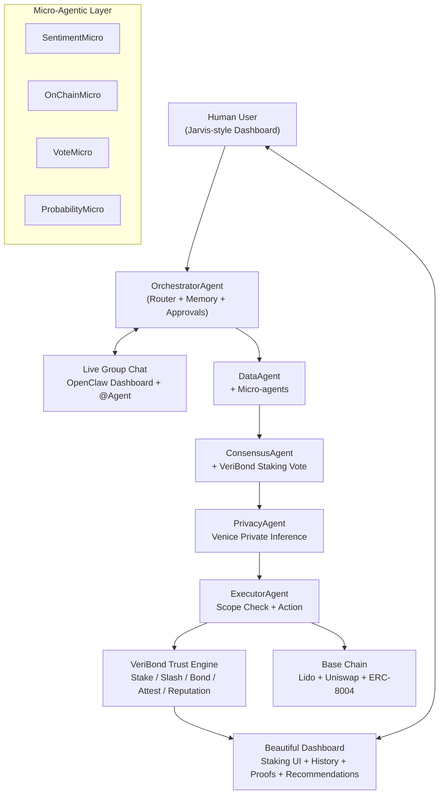
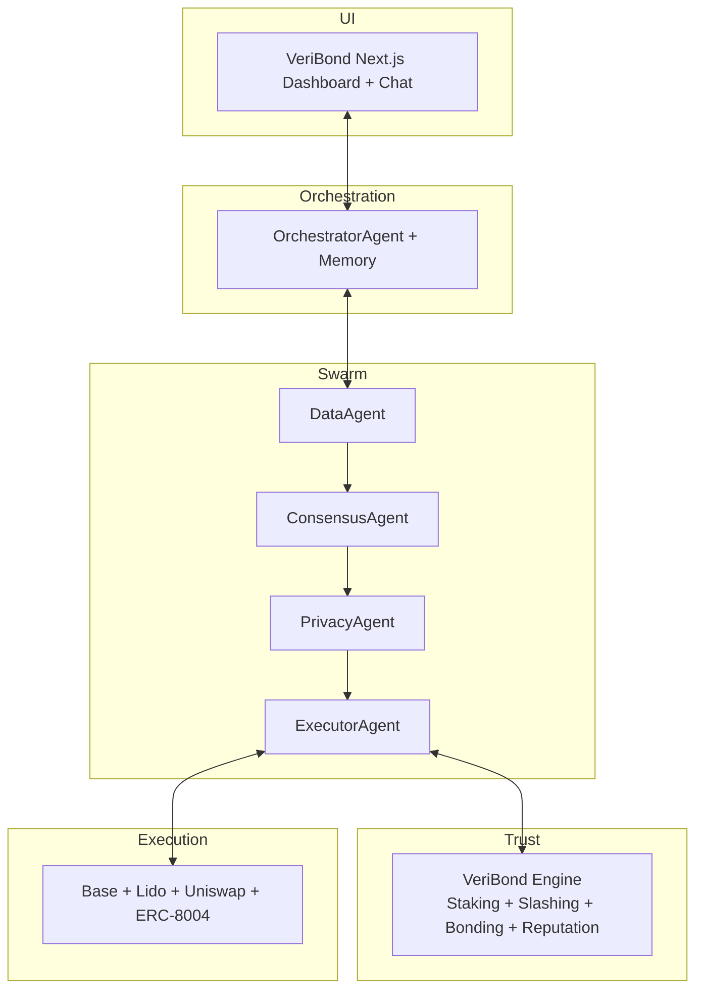
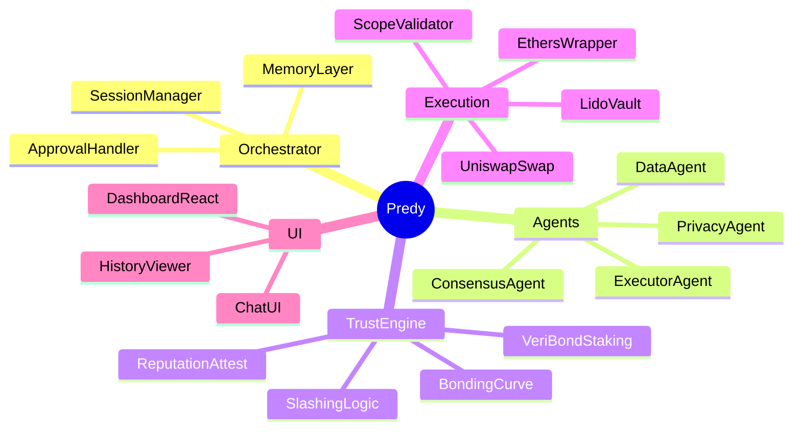
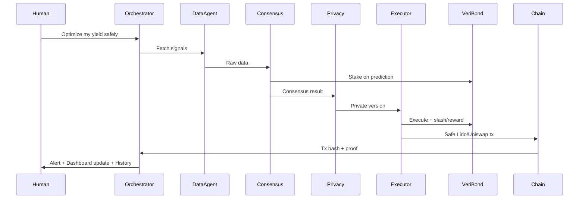

# Predy Architecture – Complete Visual & Technical Design

## 1. Overall Architecture (High-Level Flow)

## 2. Componential Architecture (Layered View)

## 3. Modular Architecture (Clean Code View)

## 4. Dataflow Architecture (End-to-End Cycle)

